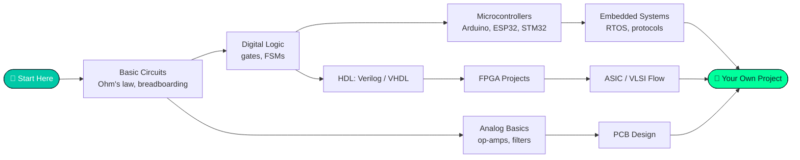

<!-- Place this file at: <your-org>/.github  →  profile/README.md  (repo must be public) -->
<!-- Replace every YOUR-ORG and the placeholder links before committing. -->

**A student-run technical society at Jamia Millia Islamia, New Delhi**

  
  
  
  

  
  
  
  
  

---

## ⚡ Who We Are

CEHS is a community for anyone curious about how electronics actually works. We run hands-on workshops, build projects, and share what we learn, covering everything from a first LED circuit to FPGAs and chip design. **No prior experience required**, just curiosity and a willingness to get your hands dirty.

---

## 🧭 What We Work On

<table>
  <tr>
    <td align="center" width="25%">
      <h3>🔌 Circuits</h3>
      Analog, power, sensors, and lab fundamentals
    </td>
    <td align="center" width="25%">
      <h3>🧠 Digital & HDL</h3>
      Logic design, Verilog / VHDL, simulation
    </td>
    <td align="center" width="25%">
      <h3>📟 Embedded</h3>
      Microcontrollers, IoT, firmware
    </td>
    <td align="center" width="25%">
      <h3>🧬 FPGA & VLSI</h3>
      Prototyping, RTL, the road to silicon
    </td>
  </tr>
  <tr>
    <td align="center">
      <h3>🛠️ PCB Design</h3>
      Schematics, layout, fabrication
    </td>
    <td align="center">
      <h3>🤖 Robotics</h3>
      Motors, control, autonomous builds
    </td>
    <td align="center">
      <h3>🎓 Workshops</h3>
      Weekly sessions and bootcamps
    </td>
    <td align="center">
      <h3>🏆 Competitions</h3>
      Hackathons and inter-college events
    </td>
  </tr>
</table>

---

## 🗺️ Learning Roadmap

Not sure where to start? Follow the path that fits you.

---

## 📂 Explore Our Repositories

| 📁 Repository | What you'll find |
|---|---|
| [**workshops**](https://github.com/YOUR-ORG/workshops) | Slides, code, schematics, and handouts from every session |
| [**resources**](https://github.com/YOUR-ORG/resources) | Curated books, courses, tools, and roadmaps |
| [**projects**](https://github.com/YOUR-ORG/projects) | Index of society projects, past and ongoing |
| [**handbook**](https://github.com/YOUR-ORG/handbook) | How the society runs, how to join, event calendar |
| [**website**](https://github.com/YOUR-ORG/website) | Source for our public site |

<b>🎓 Click to see our workshop format</b>

 

Every workshop follows the same pattern, so anyone can run one:

1. **Concept**: a short talk on the idea
2. **Demo**: a live build or simulation
3. **Hands-on**: participants build it themselves
4. **Take-home**: a small challenge and the repo link

Want to run a session? Use our workshop template repository and open an issue to book a slot.

<b>🛠️ Click to see tools and platforms we use</b>

 

  
  
  
  
  
  
  
  

---

## 🤝 Get Involved

| I want to... | Do this |
|---|---|
| 🎒 **Join the society** | Fill out the [membership form](https://YOUR-FORM-LINK) |
| 🧪 **Pitch a project** | Open an issue in [projects](https://github.com/YOUR-ORG/projects/issues) |
| 🎤 **Run a workshop** | Open an issue in [workshops](https://github.com/YOUR-ORG/workshops/issues) |
| 🐛 **Improve our material** | Read the [contribution guide](https://github.com/YOUR-ORG/.github/blob/main/CONTRIBUTING.md) and send a PR |
| 💬 **Just ask a question** | Start a thread in [Discussions](https://github.com/orgs/YOUR-ORG/discussions) |

New here? Look for issues labeled
 across our repos.

---

### 💡 *"If you can't build it, you don't fully understand it."*

Made with ☕ and solder fumes by the CEHS team · Jamia Millia Islamia

